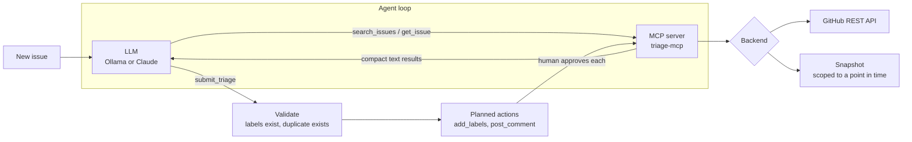

# triage-agent

**An LLM agent that triages new GitHub issues by picking a type label and area labels and finding duplicates. It works through its own MCP server and is benchmarked against what the maintainers of a real project actually did.**

The benchmark replays **120 real issues from [astral-sh/uv](https://github.com/astral-sh/uv)**, 40 of which the maintainers closed as duplicates. Each one is triaged against a 10k-issue snapshot of the tracker as it was on the day the issue was filed. All runs are local models on a laptop RTX 4050 (6 GB). Full table: [`eval/results/results.md`](eval/results/results.md).

## Results

| Model | Strategy | Type accuracy | Duplicate recall | Duplicate precision | False-duplicate rate | Tool calls | p50 latency | Tokens in |
|---|---|---:|---:|---:|---:|---:|---:|---:|
| llama3.2:3b | zero-shot | 73.9% | 0% | n/a | 0% | 0 | 1.4 s | 1.1k |
| llama3.2:3b | rag | **75.7%** | 2.5% | 50.0% | 1.2% | 0 | 1.7 s | 1.4k |
| llama3.2:3b | agent | 51.3% | 0% | 0% | 18.8% | 2.7 | 10.2 s | 10.7k |
| qwen3:4b-instruct | zero-shot | **76.5%** | 0% | n/a | 0% | 0 | 3.3 s | 1.1k |
| qwen3:4b-instruct | rag | **76.5%** | 15.0% | **37.5%** | 8.8% | 0 | 3.7 s | 1.4k |
| qwen3:4b-instruct | agent | 72.2% | **22.5%** | 22.5% | 27.5% | 3.4 | 9.1 s | 10.0k |

*Type accuracy is over the 115 issues with exactly one type label. Duplicate recall is over the 40 duplicates. The false-duplicate rate is over the 80 issues that weren't duplicates.*

What the numbers say:

- **Only an agent with a capable model finds duplicates beyond what one search can surface.** A single title search puts the true duplicate in the top 5 for just 13 of 40 duplicates (32%), so that is the ceiling for `rag`. qwen's agent ran several searches of its own choosing and found 9 of 40 (22.5%), the best recall in the table.
- **That recall costs precision.** Having seen similar issues, the 4B agent calls "duplicate" too readily: it flagged 22 of the 80 non-duplicates (27.5%). `rag` has the best precision at 37.5%. As shipped, a human approves every comment, and a duplicate is only *suggested*, never closed. That is the right default at this precision.
- **The extra context costs some type accuracy.** On both models the agent's type accuracy is below the single-turn strategies, with about 7× the input tokens and 3–6× the latency.
- **A 3B model can't run the loop.** llama3.2:3b had to be forced to submit on 67% of issues, ticked so many area labels that 46% of its area sets were rejected, and dropped to 51% type accuracy. For a model this size, plain `rag` is the right choice. The harness guardrails (forced structured submit, label validation, area cap) are what kept its output well-formed at all.
- **Area labels are weak ground truth.** uv maintainers apply `area:` labels to a small minority of issues, so area precision is low for every configuration. Some of those "false positives" are probably reasonable labels nobody applied. Area metrics are in the full table but aren't used to compare strategies.

### What changed after the first run

The first agent run (kept in [`eval/results-v1`](eval/results-v1)) exposed problems that only show up with real model output:

1. **Lists sent as strings.** llama3.2 sometimes passed `areas` as the string `"['area:cli']"`. The validator iterated over it character by character and logged hundreds of one-letter "invalid labels". The validator now parses JSON-ish strings and comma lists (`_as_list`).
2. **Searching only open issues.** The model set `state: "open"` on nearly every search, and duplicates usually point at an issue that is already *closed*. The tool description now says to leave `state` as `all`, and `limit` is clamped to at least 3 because the model kept asking for a single hit.
3. **Submitting without looking.** In v1, 82 of 120 agent runs submitted without a single tool call. The agent now gets one rejection ("search existing issues at least once") if it tries to submit before searching.
4. **Runaway generations.** One forced submit generated for minutes. Ollama calls now cap `num_predict`.
5. **Every area at once.** Under constrained decoding the 3B model sometimes listed all 34 area labels. More than 3 areas is now treated as noise and dropped (`areas_rejected`).

After these fixes, llama's agent searched on 39 of the 40 duplicates, up from 4 of 40 in v1. It still can't make good use of what it finds, and the table above says so rather than hiding it. qwen was only benchmarked after the fixes.

## How it works



**The MCP server** (`triage-mcp`) exposes `search_issues`, `get_issue` and `list_labels`, plus `add_labels` and `post_comment` when writes are enabled. It is a normal stdio MCP server, so Claude Desktop, Claude Code or any other MCP client can use it, not just this agent. Writes have three modes: `off` (the tools aren't registered at all), `dry-run` (they say what they would do) and `live`.

**The agent** never writes anything itself. It investigates with read tools and then calls `submit_triage`, a structured decision with a type, areas, `duplicate_of` and a summary. The harness then:

1. **Validates** the decision. Labels that don't exist are dropped and counted. A `duplicate_of` is checked against the tracker through the MCP server, so a made-up issue number never reaches a comment.
2. **Plans** the writes the decision implies: add labels, and post a comment naming the possible duplicate.
3. **Asks a human** to approve each write before it goes through the MCP server. Closing an issue is deliberately not a tool.

**Reliability with small models.** A 3B local model doesn't always call tools when it should. The loop handles this:
- If the model answers in prose instead of calling a tool, it gets a nudge.
- If it runs out of tool budget, it is *forced* to submit. Claude does this through `tool_choice`. Ollama does it through a JSON-schema constrained response, so the forced decision is always well-formed, with labels restricted to the real label set by an `enum`.

### Three strategies, one code path

| Strategy | What the model gets | Tool calls |
|---|---|---|
| `zero-shot` | The issue and the label set | none |
| `rag` | The issue, the label set, and the top 5 title-search hits, retrieved by the harness | 0 by the model |
| `agent` | The issue, the label set, and `search_issues` / `get_issue` | up to 4, chosen by the model |

They share the prompt, the validation and the scoring. The only difference is who decides what to look at.

## How the benchmark works

- **Ground truth is what the maintainers did.** `triage fetch` snapshots every issue in a repository through the GitHub GraphQL API. The benchmark samples issues the maintainers already triaged: the type label they applied, any `area:` labels, and, for issues they closed as duplicates, which issue they pointed to (GitHub's own duplicate link, else a "Duplicate of #N" comment).
- **No peeking at the future.** Each issue is triaged against the tracker *as it was when that issue was filed*. Later issues don't exist, issues closed later show as open, and the issue itself is hidden. Without this, the agent could search its way to the answer.
- **No comments.** The snapshot leaves comments out entirely, because on a duplicate the comments usually contain the answer.
- **Mechanical metrics only.** Type accuracy, duplicate recall and precision, false-duplicate rate on issues that weren't duplicates, area precision and recall, invalid labels, forced submits, tool calls, latency and tokens. No LLM judge is involved.

## Quickstart

```bash
pip install -e ".[dev]"          # add ,anthropic for Claude
ollama pull llama3.2:3b

# Triage a live issue (dry run: nothing is written)
triage run astral-sh/uv 12345

# Write for real, approving each action
triage run your-org/your-repo 42 --apply
```

### Use the MCP server from Claude Desktop or Claude Code

```json
{
  "mcpServers": {
    "issue-triage": {
      "command": "triage-mcp",
      "args": ["--repo", "astral-sh/uv", "--writes", "dry-run"]
    }
  }
}
```

### Reproduce the benchmark

```bash
triage fetch astral-sh/uv                                  # ~10k issues, about 6 minutes
triage build-eval --snapshot data/astral-sh__uv --out eval/datasets/uv.jsonl
triage eval --snapshot data/astral-sh__uv --dataset eval/datasets/uv.jsonl --provider ollama --model llama3.2:3b
triage report --snapshot data/astral-sh__uv --dataset eval/datasets/uv.jsonl
```

`triage eval` appends to one JSONL per model and strategy and resumes where it stopped. Each record holds the full decision, every tool call with its arguments and latency, token counts, and the gold labels.

## Project layout

```
src/triage/
  mcp_server.py   MCP server: tools, write modes, stdio entry point
  backends.py     GitHub REST backend and the read-only snapshot backend
  store.py        Issue snapshot with BM25 search, scoped to a point in time
  agent.py        Triage loop, strategies, decision validation, action planning
  llm.py          Tool-calling adapters for Ollama and Claude
  eval.py         Eval-set sampling, the benchmark runner, metrics and report
  fetch.py        GraphQL snapshotter (issues, labels, duplicate links)
  cli.py          `triage` command
tests/            Store scoping, MCP server, agent loop with a scripted model, metrics
eval/             Dataset (issue numbers + gold labels) and results
```

## Limitations and next steps

- **One repository, 120 issues, small local models.** The confidence intervals are wide (±8 points on type accuracy). The next step is a frontier model (`--provider anthropic`) and a second repository with a different labeling culture.
- **BM25 only.** Duplicates are often worded differently from the issue they duplicate. Adding the dense and hybrid retrieval measured in [AskDocs](https://github.com/Yash06B/askdocs) to `search_issues` should raise the 32% single-search ceiling.
- **Duplicate precision.** A verification step (re-read the candidate and answer "same root cause?" as a separate yes/no call) is the obvious fix for the agent's false duplicates.
- **Snapshot labels are current, not historical.** Issues that existed when the target was filed show today's labels, which can include labels added later. State is rolled back (closed later → open); labels aren't.

## License

MIT
